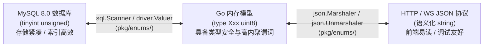

# 领域枚举强类型三层映射与零值安全体系

## 1. 三层映射架构拓扑

全系统严格遵循**“底层存储数值化、代码层强类型化、外层传输语义化”**的三层转换设计：



1. **数据库底层**：强制采用 `tinyint unsigned`，严禁无注释裸数字；
2. **外部协议层**：HTTP/WebSocket API 强制输出英文小写语义化字符串（如 `"online"`、`"in_progress"`）；
3. **Go 代码层**：统一收敛在 `pkg/enums/`，按业务领域拆分独立源文件（严禁单文件堆砌）。

---

## 2. 零值安全与数值划分法则 (Zero-Value Safety)

| 枚举分类 | 典型场景 | 取值规约 | 防御机理 |
| :--- | :--- | :--- | :--- |
| **二元状态 / 启停开关** | `is_deleted`, `status` 启用停用, `is_guest` | **`0` 与 `1`**<br/>• `0`: 否 / 关 / 停用 / 默认无<br/>• `1`: 是 / 开 / 启用 / 存在 | 符合直觉，天然对齐 Go 结构体零值默认安全（如未显式配置时默认为未删除/未启用）。 |
| **多元枚举 / 业务分类 / 状态机** | `SenderType`, `SessionStatus`, `MessageType` | **业务有效值必须从 `1` 开始递增**<br/>• **`0` 强制预留为 `Unknown` / `None` 占位** | **坚决防范零值穿透**：防止因 DTO 漏传、反序列化缺失或变量未初始化时意外击穿为有效业务状态。 |

---

## 3. 标准枚举精炼标杆范式 (`pkg/enums/`)

以坐席状态 `AccountStatus` 为例，实现强类型与协议/驱动契约（15 行核心骨架）：

```go
package enums

type AccountStatus uint8

const (
	AccountStatusUnknown AccountStatus = iota // 0 强制预留为 Unknown 占位，防零值击穿
	AccountStatusOnline                       // 1
	AccountStatusBusy                         // 2
	AccountStatusOffline                      // 3
)

// 1. 语义化标识与中文释义
func (a AccountStatus) String() string { return map[AccountStatus]string{1: "online", 2: "busy", 3: "offline"}[a] }
func (a AccountStatus) Desc() string   { return map[AccountStatus]string{1: "在线", 2: "忙碌", 3: "离线"}[a] }

// 2. API 传输层 JSON 序列化 (输出 string) 与双模反序列化 (兼容 string 与 int)
func (a AccountStatus) MarshalJSON() ([]byte, error)   { return json.Marshal(a.String()) }
func (a *AccountStatus) UnmarshalJSON(b []byte) error {
	var s string
	if err := json.Unmarshal(b, &s); err == nil { *a = ParseAccountStatus(s); return nil }
	var n uint8
	if err := json.Unmarshal(b, &n); err == nil { *a = AccountStatus(n); return nil }
	return fmt.Errorf("invalid AccountStatus: %s", string(b))
}

// 3. 数据库存储驱动契约 (driver.Valuer 写入 tinyint, sql.Scanner 读取 int64/[]byte)
func (a AccountStatus) Value() (driver.Value, error) { return int64(a), nil }
func (a *AccountStatus) Scan(v any) error {
	switch val := v.(type) {
	case int64:  *a = AccountStatus(val)
	case []byte: n, _ := strconv.Atoi(string(val)); *a = AccountStatus(n)
	default:     *a = AccountStatusUnknown
	}
	return nil
}

// 4. 高内聚业务谓词 (🚨 严禁在 Logic 业务层书写裸数字比较)
func (a AccountStatus) CanAcceptSession() bool { return a == AccountStatusOnline }
func (a AccountStatus) IsAvailable() bool       { return a == AccountStatusOnline || a == AccountStatusBusy }
```

---

## 4. 与代码生成器深度搭配方案 (Gen Integration)

### 4.1 GORM Gen 强类型映射配置 (`cmd/gen/generate.go`)
通过 GORM Gen 的 `FieldType` 机制，将 MySQL 底层 `tinyint` 字段在代码生成期直接绑定为 `pkg/enums` 强类型：

```go
package main

import "gorm.io/gen"

func main() {
	g := gen.NewGenerator(gen.Config{
		OutPath: "./pkg/query",
		Mode:    gen.WithDefaultQuery | gen.WithQueryInterface,
	})

	// 核心: 将 tinyint 字段强类型绑定到枚举 (依赖 Value/Scan 接口实现无感转换)
	g.ApplyBasic(
		g.GenerateModel("rocky_accounts",
			gen.FieldType("status", "enums.AccountStatus"),
		),
		g.GenerateModel("rocky_sessions",
			gen.FieldType("status", "enums.SessionStatus"),
			gen.FieldType("source_type", "enums.SourceType"),
		),
	)

	g.Execute()
}
```

#### 生成收益与查询范式
- **生成的实体 Struct**：字段直接为 `Status enums.AccountStatus`，业务代码天然享有 `account.Status.CanAcceptSession()` 领域方法；
- **生成的类型安全查询**：
  ```go
  // 强类型安全查询，严禁裸写 Where("status = 1")
  accounts, err := query.RockyAccounts.WithContext(ctx).
      Where(query.RockyAccounts.Status.Eq(enums.AccountStatusOnline)).
      Find()
  ```

### 4.2 goctl model 契约对齐方案
- 在手写扩展层（`pkg/model/*_model.go`）中，自定义查询与更新方法入参强制使用强类型枚举（如 `UpdateStatus(ctx, id, status enums.SessionStatus)`），拒绝裸整型；
- 在转换为 API DTO 时，直接利用 `status.String()` 赋值给契约响应字段。

---

## 5. 全局枚举字典统一出口 (`/common/enums`)

为解耦前端硬编码，通用模块提供 `{value, name, desc}` 元数据输出：

```go
// CommonEnumsResp 供前端启动时拉取字典，动态渲染下拉菜单与标签
resp = &types.CommonEnumsResp{
	AccountStatuses: []types.EnumItem{
		{Value: int(enums.AccountStatusOnline), Name: enums.AccountStatusOnline.String(), Desc: enums.AccountStatusOnline.Desc()},
		{Value: int(enums.AccountStatusBusy), Name: enums.AccountStatusBusy.String(), Desc: enums.AccountStatusBusy.Desc()},
	},
}
```

---

## 6. 单元测试验证门禁 (`enums_test.go`)

新增枚举必须提供覆盖五大维度的自动化测试：
1. `String()` 与 `Desc()` 映射完整性测试；
2. 业务谓词方法（Predicate Methods）布尔逻辑覆盖；
3. `ParseXxx` 对合法字符与非法字符（兜底 `Unknown`）的兼容性；
4. `json.Marshal` 与 `json.Unmarshal` 双模反序列化（String 与 Int 均可正确恢复）；
5. `driver.Valuer` 写入与 `sql.Scanner` 读取（`int64` 及 `[]byte`）准确性。
